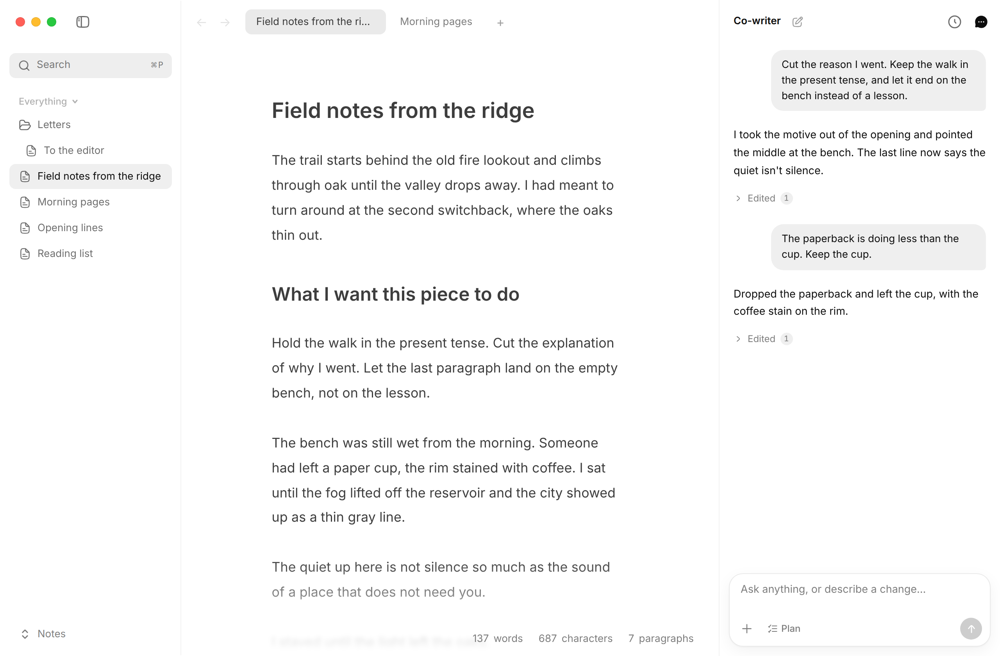
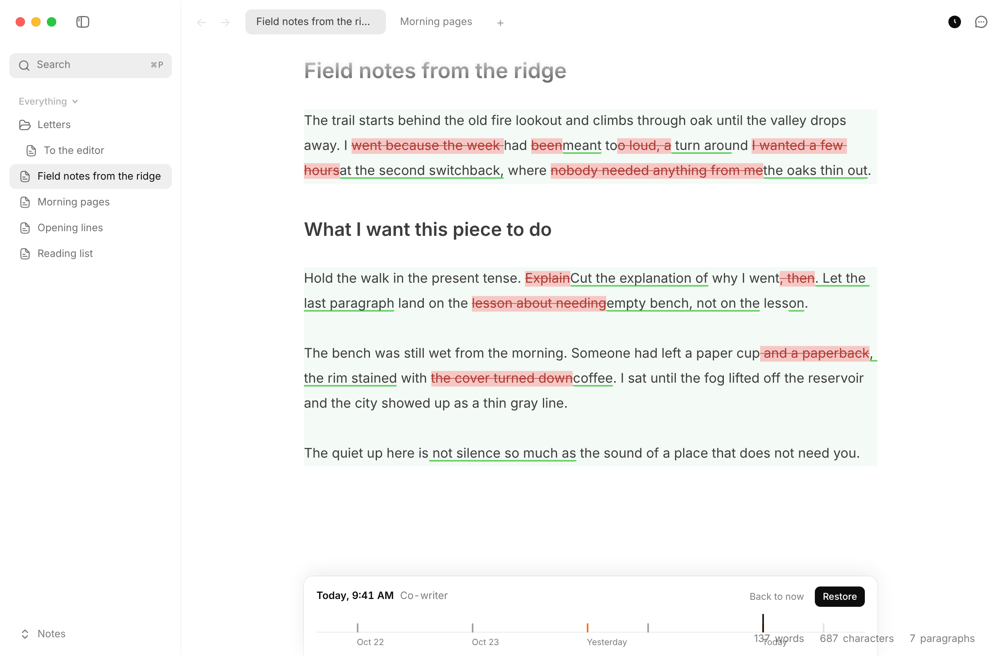
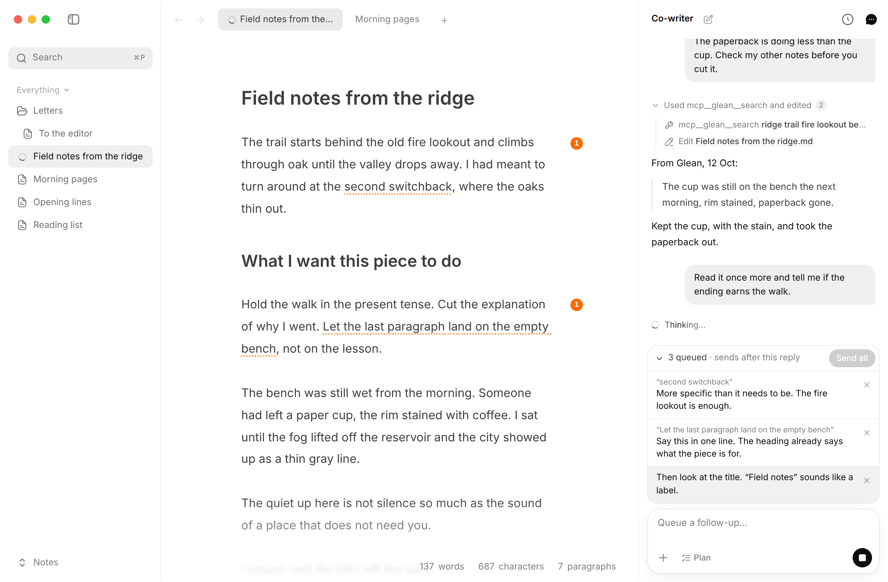

# Co-writer

Co-writer is a fork of [Writer](https://github.com/joelbqz/writer-computer). It adds an AI writing partner and ships as its own app, so it can sit next to Writer without replacing it. The main differences:

- **Co-writer.** A panel (⌘⇧L) that runs your installed Claude Code or Codex CLI next to the note, with its own sign-in and permissions. Choose the agent in Settings → Co-writer → Agent. Ask it to edit the note, select text or ⌥-click a paragraph to point it at something, queue messages, attach files, mention other notes with @, and use your skills and MCP servers. Each note keeps its own conversation. The agent edits the open note directly, and asks before writing other notes or using tools, unless you've allowed that kind of request. Claude Code also asks before reading files outside the workspace. Codex can read them without asking.
- **Version history.** Go back to earlier versions of a note (⌘⇧H). All of the agent's edits from one reply are saved as a single version.
- **Embeds.** Fenced ` ```html embed ` blocks run live HTML, CSS and JavaScript in a sandbox inside the note, for prototypes, charts and diagrams.
- **No telemetry.** Co-writer sends no usage data.
- **Its own app.** A separate name, bundle identifier and `cowriter` terminal command. On first launch it imports your settings from Writer if you have it installed.
- **Separate releases.** Builds are published on [this repo's releases](https://github.com/gustavscirulis/co-writer/releases), and the in-app updater follows them instead of upstream's.

Co-writer needs the [Claude Code CLI](https://code.claude.com) (2.1.296 or later) or the [Codex CLI](https://github.com/openai/codex) (0.162.1 or later) installed and signed in. Co-writer bundles neither and doesn't handle your accounts. See [`docs/third-party.md`](./docs/third-party.md) for license and attribution notes, and [`CHANGELOG.md`](./CHANGELOG.md) for everything that has changed since 2026-10-10, when this fork started.

<p align="center">
  
</p>

<p>Co-writer sits beside the note. It can edit the text, and it can use your existing skills and MCP servers.</p>

<p align="center">
  
</p>

<p>Version history keeps earlier versions of a note. Select one to see the inline diff, and restore it to bring that version back.</p>

<p align="center">
  
</p>

<p>Leave comments in-line and queue up multiple to address in one go.</p>

## Repository

- `apps/desktop/` — Tauri desktop app.
- `apps/desktop/src/` — React frontend.
- `apps/desktop/src-tauri/src/` — Rust commands, workspace state, watcher, updater, and CLI integration.
- `docs/` — project and agent workflow docs.
- `SPECs/` — feature specs and design notes.

## Development

This repo uses Vite+ through the `vp` CLI. Use `vp` instead of calling the package manager or Vite tooling directly.

```bash
vp install
vp dev
```

## Validation

```bash
vp check
vp test
```

Rust validation runs from the Tauri crate:

```bash
cd apps/desktop/src-tauri
cargo test
cargo clippy
cargo fmt --check
```

## Privacy

Co-writer is local-first and stays that way. It sends no telemetry or usage data.

## Releases

macOS releases of this fork are cut locally with `scripts/distribute.sh` and published to this repo's GitHub releases. See [`docs/releasing.md`](./docs/releasing.md) for the one-time signing setup and the release steps.
